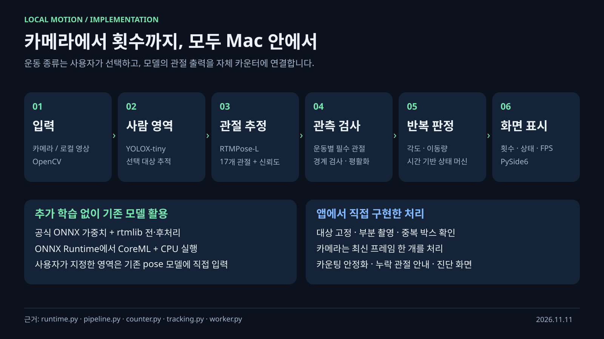
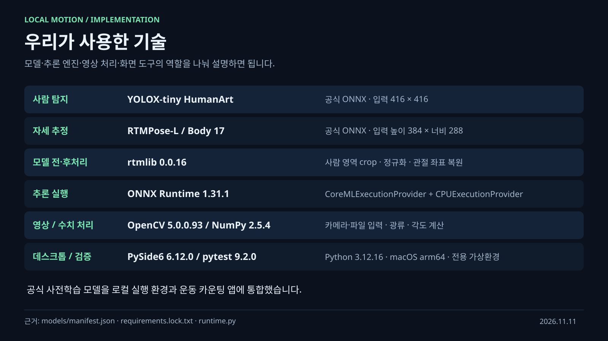
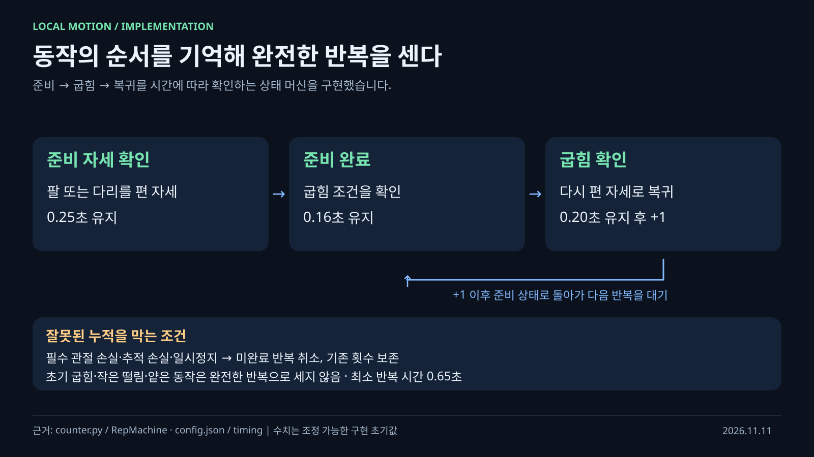
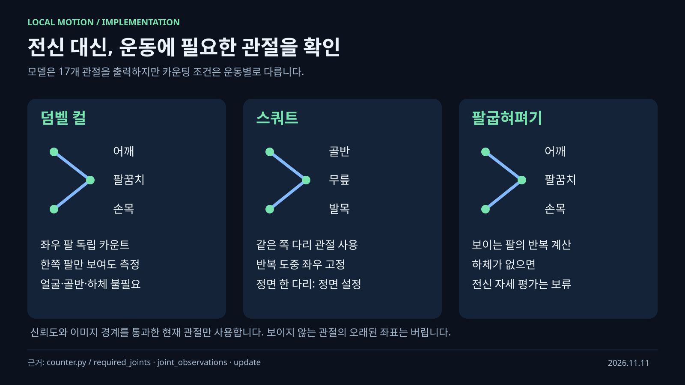
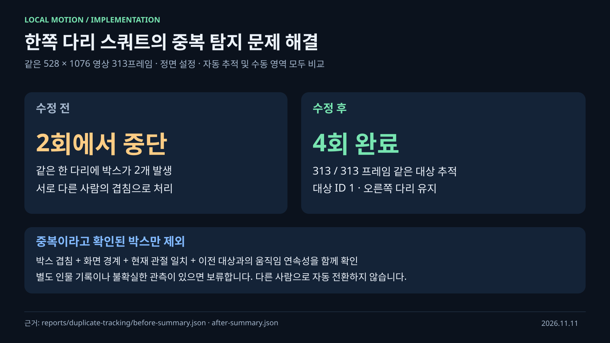
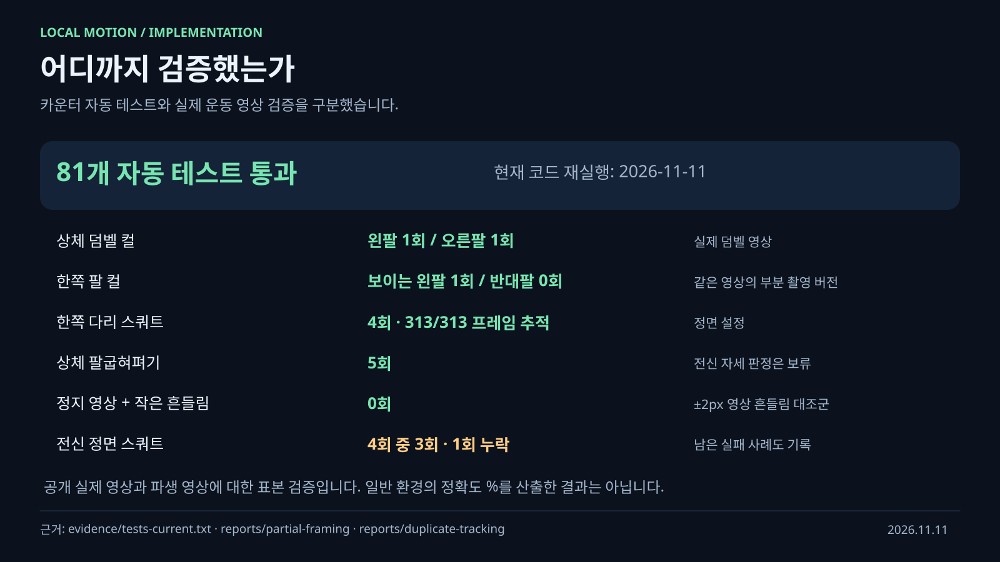
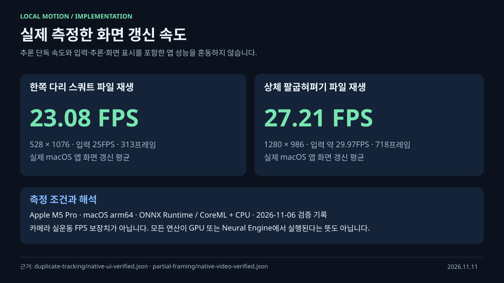

# Local Motion 구현 요약

공식 사전학습 YOLOX-tiny HumanArt와 RTMPose-L을 사용해 Apple Silicon Mac에서 팔굽혀펴기·스쿼트·덤벨 컬을 셉니다. RTMPose-L은 17개 관절 좌표와 신뢰도를 출력합니다. 앱은 ONNX Runtime의 CoreML·CPU 실행 경로와 PySide6 화면을 사용합니다.

직접 구현한 부분은 운동별 필수 관절 검사, 관절 각도와 시간 조건을 이용한 반복 판정, 대상 추적과 중복 탐지 처리입니다. 모델 가중치는 공개된 공식 파일을 사용했습니다.

| 운동 | 필수 관절 | 측정 범위 |
| --- | --- | --- |
| 덤벨 컬 | 어깨·팔꿈치·손목 | 좌우 팔을 독립적으로 계산 |
| 스쿼트 | 골반·무릎·발목 | 보이는 다리 길이로 골반 하강량을 정규화 |
| 팔굽혀펴기 | 어깨·팔꿈치·손목 | 보이는 팔로 반복 계산, 몸통·하체 가림 시 전신 자세 평가 보류 |

한쪽 다리 스쿼트 영상에서는 같은 대상의 중복 탐지를 처리한 뒤 2회 중단에서 4회 완료로 개선됐습니다. 자동 테스트 81개를 통과했습니다. 기존 macOS 앱에서 스쿼트와 팔굽혀펴기 파일을 재생했을 때 평균 화면 갱신은 각각 23.08FPS와 27.21FPS였습니다. 전신 정면 스쿼트 표본에서는 1회 누락이 남아 있습니다.

[발표 원고](발표원고.txt) · [평가 미디어 출처](../assets/SOURCES.md)

