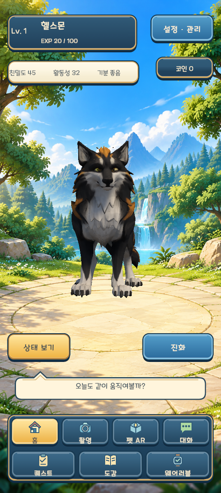

# HealthMon 세로 게임 UI · feature/ui

이 브랜치는 기존 Unity 프로젝트에 세로 UI를 적용한 작업본입니다. 시작 화면, 내 캐릭터 선택, 홈, 음식 분석·기록, 대화, 퀘스트, 상태, 도감, 웨어러블, 설정·관리 화면을 포함합니다.



## 친구가 실행하는 방법

HealthyMon/healthmon-capstone 저장소를 받은 상태에서 실행합니다. 아래 `origin`은 해당 팀 저장소를 가리켜야 합니다.

```sh
git fetch origin
git switch feature/ui
git lfs pull
```

1. Unity Hub에서 `Client/HealthMonUnity` 폴더를 엽니다. 프로젝트 버전은 **6000.4.6f1**입니다.
2. `Assets/HealthMon/Scenes/MainARScene.unity`를 열고 Play를 누릅니다.
3. Game 뷰는 `HealthMon/UI/Select portrait Game view` 메뉴로 1080×2400을 선택할 수 있습니다. Android 방향 설정도 세로로 적용되어 있습니다.
4. 시작 화면에서 이어서 시작하거나 캐릭터 선택으로 들어갑니다. 게임에 들어간 뒤 홈의 이름·레벨 카드를 누르면 내 캐릭터 선택을 다시 열 수 있습니다.
5. 서버는 저장소의 기존 원클릭 실행 방법으로 준비합니다. 기존 계정·서버에 연결하면 해당 계정의 캐릭터 목록과 선택된 캐릭터를 사용합니다.

UI는 이미 씬에 적용되어 있으므로 이전 디자인 패키지를 추가로 임포트할 필요가 없습니다. 이 PC의 별도 작업본 위치는 `E:\qwen-llm\healthmon-ui\Client\HealthMonUnity`입니다.

## 적용 내용

- 1080×2400 기준 Canvas, 화면 너비에 따른 배율, 기기의 안전 영역 대응. 1080×1920도 확인했습니다.
- 기존 7개 메뉴를 4+3 두 줄로 배치하고 버튼·입력·체크 영역을 확대했습니다.
- 파랑·금색·크림색 패널과 아이콘을 개별 Sprite로 적용했습니다. 텍스트는 TMP와 기존 서버 값으로 표시합니다.
- 기존 3D 캐릭터는 그대로 렌더링하며 홈·시작·선택·대화의 화면 위치에 맞춰 배치합니다. 배경은 캐릭터 뒤의 별도 면입니다. 실제 AR과 모바일 음식 촬영 화면에서는 배경을 숨깁니다.
- 캐릭터 목록 조회, 선택, 새 캐릭터 생성은 기존 인증 API와 연결 절차를 사용합니다. 새 캐릭터는 사용자가 이름을 입력하고 만들기를 눌렀을 때만 생성합니다. 진행 중인 진화·대화·연결 작업이 있으면 전환을 막습니다.
- 기존 음식 저장·대화 전송·퀘스트·웨어러블 처리와 버튼 이벤트를 유지하고 표시 위치와 모양을 바꿨습니다. 설정의 캐릭터·운동·퀘스트·연결 탭은 기존 기능을 사용합니다.

## 파일 안내

| 위치 | 내용 |
| --- | --- |
| `Assets/HealthMon/Resources/HealthMon/PortraitUI` | 게임에서 사용하는 122개 PNG, Sprite 메타데이터, 배경 머티리얼 |
| `Assets/HealthMon/Scripts/UI/PortraitGameUI.cs` | 기존 컨트롤의 세로 배치와 스타일 |
| `Assets/HealthMon/Scripts/UI/PortraitCharacterMenu.cs` | 실제 시작·내 캐릭터 선택 UI |
| `Assets/HealthMon/Scripts/Editor/PortraitGameUIEditor.cs` | 씬 적용 도구와 버튼·배치 검증 |
| `Assets/HealthMon/Scripts/Editor/PortraitGameUIVerification.cs` | 실제 Unity 카메라로 화면 캡처 |
| `Docs/UI/Source` | 수정 가능한 개별 UI SVG 원본 |
| `Docs/UI/Native` | 실제 Unity 씬 렌더링 20장 |
| `Docs/UI/asset-sheet.png` | 개별 에셋 목록 미리보기 |

PNG 파일의 이름, 테두리와 크기는 [asset-manifest.json](asset-manifest.json)에 정리했습니다. 배경은 built-in ImageGen으로 만들었고, UI 패널·아이콘은 SVG로 작성했습니다. 프롬프트는 [generation-prompts.json](generation-prompts.json)에 있습니다. 디자인 시안의 2D 캐릭터 이미지는 게임에 포함하지 않았습니다.

## 검증 범위

2026-10-25에는 기존 로컬 서버에 연결한 Unity 재생 테스트도 진행했습니다. 확인된 동작과 남은 검증은 [실행 테스트 결과](LIVE_TEST_20261025.md)에 구분했습니다.

별도 UI 작업본에서 기존 서버를 재사용할 때는 Git에서 제외되는 `.runtime/editor-connection.json`에 `base_url`, `pet_id`, `session`을 둘 수 있습니다. `session`은 같은 작업본의 `.runtime` 안에 있는 기존 연결 정보 파일을 가리킵니다. 이 설정은 서버 설치용 `native-server.json`과 분리돼 원클릭 서버 실행 설정을 덮어쓰지 않습니다.

Unity 6000.4.6f1에서 스크립트를 컴파일하고 기존 버튼 연결, 식사 구분 선택, 메뉴 이동, 설정 4개 탭의 주 동작, 반복 배치와 설정 버튼 위치를 검사했습니다. 9:20·9:16 두 비율로 10개 화면씩 렌더링했습니다.

캡처는 서버에 쓰지 않는 오프라인 검증입니다. 로컬에 저장된 리깅 GLB를 시각 검증용으로 불러왔으며, 표시되는 레벨·수치는 씬의 검증 값입니다. 실제 사용자의 상태를 변경한 화면이 아닙니다. 라이브 서버의 사진 저장·LLM 응답·진화와 휴대폰·워치 실기기 검증은 이 UI 검증에 포함되지 않습니다. 상세 결과는 [verification.json](verification.json)을 확인하세요.

| 화면 | Unity 캡처 |
| --- | --- |
| 시작 | [9:20](Native/native-PortraitStartPanel.png) · [9:16](Native/native-PortraitStartPanel-1920.png) |
| 내 캐릭터 선택 | [9:20](Native/native-PortraitCharacterPanel.png) · [9:16](Native/native-PortraitCharacterPanel-1920.png) |
| 홈 | [9:20](Native/native-HomePanel.png) · [9:16](Native/native-HomePanel-1920.png) |
| 음식 기록 | [9:20](Native/native-FoodScanPanel.png) · [9:16](Native/native-FoodScanPanel-1920.png) |
| 대화 | [9:20](Native/native-DialoguePanel.png) · [9:16](Native/native-DialoguePanel-1920.png) |
| 퀘스트 | [9:20](Native/native-QuestPanel.png) · [9:16](Native/native-QuestPanel-1920.png) |
| 설정·관리 | [9:20](Native/native-AdminPanel.png) · [9:16](Native/native-AdminPanel-1920.png) |
| 도감 | [9:20](Native/native-CollectionPanel.png) · [9:16](Native/native-CollectionPanel-1920.png) |
| 상태 | [9:20](Native/native-StatusPanel.png) · [9:16](Native/native-StatusPanel-1920.png) |
| 웨어러블 대기 | [9:20](Native/native-WearablePanel.png) · [9:16](Native/native-WearablePanel-1920.png) |
